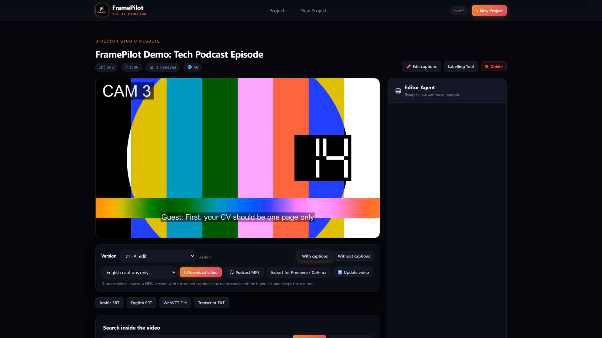
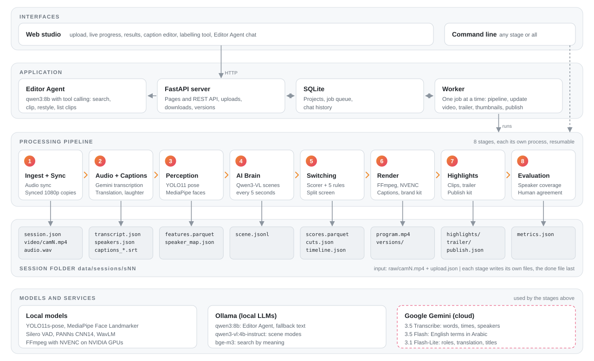
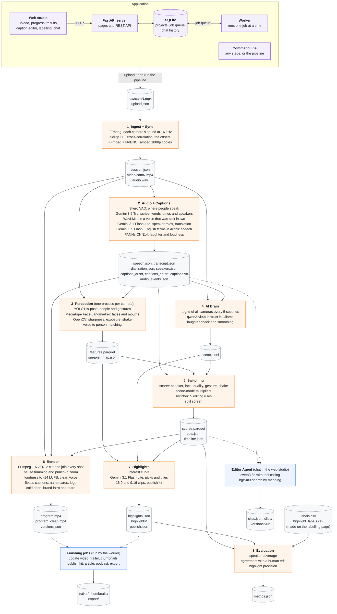

# FramePilot


FramePilot turns a multi-camera recording into a finished, edited video. You upload one file per camera, and it
syncs the cameras, decides who should be on screen at every moment, adds Arabic and English captions, and cuts
highlight clips for social media. An Editor Agent then takes requests in plain Arabic or English, such as
"make a one-minute vertical clip about salaries" or "show the guest more".

It is built for podcasts, interviews and panel discussions recorded with phones or simple cameras: one wide shot
plus a close-up camera for each seat.



## Contents

- [Features](#features)
- [Architecture](#architecture)
- [Repository structure](#repository-structure)
- [Requirements](#requirements)
- [Getting started](#getting-started)
- [Run components directly](#run-components-directly)
- [Configuration](#configuration)
- [Exports](#exports)
- [Results](#results)
- [Verification](#verification)
- [Roadmap](#roadmap)
- [Team](#team)
- [License](#license)

## Features

### Automatic multi-camera editing

- **Audio sync.** Each camera's offset is found by cross-correlating its sound with the wide camera. Synced 1080p
  copies at a constant 30 fps are made once, and every video is cut from them.
- **Who is talking, and on which camera.** YOLO pose finds every person, and MediaPipe face landmarks measure each
  person's mouth movement from a full-resolution head crop. Each voice is matched to the person whose mouth moves
  more than usual while that voice talks, so two people sharing one camera are told apart.
- **Scene modes.** A local vision-language model (Qwen3-VL) looks at all cameras every 5 seconds and labels the
  moment as conversation, reaction, wide energy or demo. Laughter heard in the audio confirms reactions.
- **Scoring and switching.** Every camera gets a score every 0.1 s from the speaker, face direction, image quality,
  gestures and shake, weighted by the scene mode. A switcher turns the scores into cuts with five rules:
  1. Never cut before a shot is 2 seconds old.
  2. When a new person starts talking, cut to their camera.
  3. After 15 seconds on one camera, cut away for variety (to the wide shot, or from the wide shot to the best
     close-up).
  4. When every camera scores low, go to the wide shot.
  5. Otherwise, cut only when another camera is at least 20 % better and stays better for 0.4 seconds.
- **Split screen.** Fast back-and-forth exchanges and visible reactions show both close-ups side by side, each half
  centred on the face of the person in the exchange.
- **Punch-in zoom.** A slow push in on a close-up at laughter and at moments much louder than usual, at most twice a
  minute.
- **Pause trimming** (optional). Silences longer than 1.5 s are shortened to 0.4 s. The cut is placed at a camera
  change so it can't be seen, and the sound stays in sync.
- **Cold open** (optional). The video opens with its strongest 6 to 12 seconds, in whole sentences, before the intro.
- **Why this shot.** Every shot has a short explanation in Arabic and English (who is talking, a reaction, variety,
  nobody clearly on screen...), shown when you hover over the on-air strip.

### Captions and languages

- **Transcription with speakers.** Gemini 3.5 Transcribe returns every word with its start and end time and a
  speaker label in one request. A second model names each speaker's role (host, guest, panelist...), and the names
  typed at upload are matched to the voices.
- **English words in Arabic speech.** A correction pass restores English technical terms that the transcriber dropped
  or wrote in Arabic letters, without rewriting the Arabic.
- **Translation.** Each line is translated with the lines around it as context, by Gemini or by the local qwen3:8b
  when Gemini is not available. Every video can show Arabic and English captions together.
- **Readable captions.** One caption per line of speech (at most 5 seconds and 42 characters, split at sentence ends),
  never two captions on screen at once, short replies joined as dialogue lines, Arabic and mixed Arabic/English lines
  in the right order, and the word being spoken lit up in clips.
- **Caption editor.** Fix any word in the browser. Word timings are kept, every save can be undone, and the original
  captions can be restored.
- **One-language videos.** Download the video with Arabic and English captions, Arabic only, English only, or none.

### Sound

- **Loudness.** The full video and every clip are brought to -14 LUFS, the level YouTube and Spotify play at, with one
  fixed gain measured once per recording.
- **Clean voice** (optional). Rumble removed, background noise reduced and voices made clearer.

### Brand kit

- Logo in any corner, in three sizes, on the video, the clips and the thumbnails.
- Intro and outro videos of up to 60 seconds.
- Caption size, text and background colours, a box or an outline, and the colour of the word being spoken.
- **Name cards:** the first time a named person talks on screen, a card with their name and role appears on the side
  where they sit.
- Music for the trailer, lowered automatically while people talk.

### Highlights and publishing

- **Highlights.** An interest curve built from loudness, laughter, energy and the scene labels proposes the strongest
  moments, cut at sentence edges, 20 to 45 seconds long. Gemini picks 3 to 5 of them and writes Arabic and English
  titles. Each becomes a 16:9 and a 9:16 clip, and in 9:16 the frame follows whoever is speaking.
- **Trailer.** A 30 to 45 second teaser from 4 to 6 strong moments, with fades through black, an end card, the brand
  outro and music, in 16:9 and 9:16.
- **Thumbnails.** For each highlight, the frame where the speaker looks best (smiling, eyes open), cropped to 1280x720
  with the title and the logo, in Arabic and English.
- **Publish kit.** YouTube chapters, an episode summary, key points, a social media post with hashtags for every
  highlight, and a ready-to-paste YouTube description.
- **Blog article.** A full article about the episode, in Arabic and English.
- **Podcast.** An MP3 of the episode with chapters and cover art.
- **Premiere Pro and DaVinci Resolve.** The edit as an FCP7 XML timeline and a CMX3600 EDL with the synced camera files
  and captions, to continue editing by hand.

### Editor Agent

A chat assistant on the results page, running locally on qwen3:8b with tool calling.

- Takes requests in Arabic, English or Franco-Arabic, for example "make a 1-minute reel about salaries" or
  "اعمل كليب دقيقة ونص عن المرتبات وركز على الضيف".
- Reads the length ("1-2 minutes", "1:20", "دقيقة ونص"), the format (TikTok, Reels, Shorts or vertical means 9:16),
  the caption languages, the number of clips, and who to show and how much ("only the guest", "mostly the host").
- Finds the moment by meaning with a bge-m3 search over the transcript, widens it to cover the whole topic, and cuts
  at sentence edges.
- Handles follow-ups such as "make it longer", "30 seconds shorter" or "make it vertical".
- Restyles the whole video, for example showing one person more or using more reaction shots. The result is a new
  version; the original is kept.
- Refers to people by name or role ("the guest") and lists every clip it made.

### Web app

- **Upload** 2 to 4 cameras with the language, the wide camera, the names and roles of the people, an optional brand
  kit, and a consent confirmation.
- **Progress** of the 8 stages with the place in the queue, a time estimate, a browser notification when the video is
  ready, and a retry button after a failure.
- **Results studio:**
  - a player with every version, with or without captions
  - a camera score timeline (click to jump) and the on-air strip with "why this shot"
  - the scene-mode strip and speaker stats (talk share, turns, longest answer, words per minute, interruptions,
    laughter)
  - search inside the video by words or by meaning
  - speaker names, the highlights gallery and the Editor Agent chat
  - the brand kit, publish kit, trailer, thumbnails and all downloads
- **Labelling tool** for making a human edit: keys 1 to 4 choose the camera and H marks a highlight.
- **Versions:** "Update video" applies edited captions, names and the brand kit as a new version. Deleted projects
  and versions go to a trash folder, not straight to deletion.
- **Arabic and English interface.**

## Architecture

<picture>
  <source media="(prefers-color-scheme: dark)" srcset="assets/architecture-dark.svg">
  
</picture>

FramePilot is split into an application layer and a processing pipeline. The two never call each other's code: they
communicate only through the files in a session folder.

- **Application.** A FastAPI server serves the web studio and a REST API, and keeps projects, the job queue and the
  chat history in SQLite. A separate worker process takes one job at a time from the queue: the full pipeline for a
  new upload, or a shorter job such as "Update video", the trailer or the thumbnails. The Editor Agent answers chat
  requests through the server.
- **Pipeline.** Eight stages, each a Python module that runs as its own process
  (`python -m ai_director.<module>.run <session>`). A stage never imports another stage: it reads the files that
  earlier stages wrote and writes its own.
- **Session folder.** One folder per recording holds every input and output. File names and formats are a contract,
  defined as Pydantic models in `ai_director/common/schemas.py` and checked by `ai_director/common/check.py`.
- **Models and services.** Vision and audio models run locally on the GPU, the language models run locally in Ollama,
  and Google Gemini handles transcription and the text-writing steps.

### Data flow

Every stage with the models it uses, and the files it reads and writes. Solid arrows are the pipeline; dotted arrows are the Editor Agent and the finishing jobs, which run on demand after the pipeline.



### Pipeline stages

| # | Stage | Package | What it does | Main technology | Done file |
|---|---|---|---|---|---|
| 1 | Ingest + Sync | `ingest` | Finds each camera's offset from its sound and makes synced copies | SciPy FFT cross-correlation, FFmpeg | `session.json` |
| 2 | Audio + Captions | `audio` | Speech detection, transcript with word times and speakers, roles, English terms, translation, captions, laughter | Silero VAD, Gemini, WavLM, PANNs | `audio_events.json` |
| 3 | Perception | `perception` | People, faces, mouth movement, gestures and image quality every 0.1 s; which camera shows each speaker | YOLO11s-pose, MediaPipe, OpenCV | `speaker_map.json` |
| 4 | AI Brain | `brain` | Scene mode every 5 s: conversation, reaction, wide energy or demo | Qwen3-VL in Ollama | `scene.jsonl` |
| 5 | Switching | `director` | Camera scores, the cut list and split screens | pandas, rule-based switcher | `cuts.json` |
| 6 | Render | `director` | The edited video with captions, brand kit, name cards, zoom and loudness | FFmpeg (NVENC or x264), libass | `program.mp4` |
| 7 | Highlights | `highlights` | Highlight clips with titles and the publish kit | interest curve, Gemini | `highlights.json` |
| 8 | Evaluation | `eval` | Speaker coverage, agreement with a human edit, highlight precision | NumPy, pandas | `metrics.json` |

### Design principles

- **Contract first.** Every file a stage writes has a schema. The checker validates a whole session in one command,
  and a small mock session with every file lets each stage be developed and tested on its own.
- **Done file last.** Each stage writes its done file at the very end, so a crash never looks finished.
- **Resumable.** The pipeline skips any stage whose done file already exists. After a failure, "Try again" continues
  from the stage that failed; deleting a file runs that stage again.
- **Isolated stages.** Each stage runs in its own process, with its own log in `logs/` and its run time in
  `logs/times.json`. A failure in the Evaluation stage only produces a warning; the video is still delivered.
- **Nothing is overwritten.** Restyles and updates become new versions in `versions/`, and deleted projects and
  versions move to a trash folder.

### Technology stack

| Layer | Technology |
|---|---|
| Web app | FastAPI, Uvicorn, Jinja2, JavaScript, Chart.js, SQLite |
| Video | FFmpeg (NVENC or libx264), libass, OpenCV |
| Vision | Ultralytics YOLO11s-pose, MediaPipe Face Landmarker |
| Audio | Silero VAD, PANNs CNN14, WavLM (Hugging Face Transformers), soundfile |
| Language | Gemini 3.5 Transcribe, Gemini 3.5 Flash, Gemini 3.1 Flash-Lite; Ollama with qwen3:8b, qwen3-vl:4b-instruct and bge-m3 |
| Data | NumPy, SciPy, pandas, PyArrow (Parquet), Pydantic |
| Exports | FCP7 XML, CMX3600 EDL, SRT, WebVTT, MP3 with ID3 chapters |
| Tests | pytest |

### The session folder

| File | Written by | Contents |
|---|---|---|
| `upload.json` | web app / you | name, language, wide camera, number of speakers, optional names |
| `session.json` | Ingest | cameras, roles, sync offsets, duration |
| `video/camN.mp4`, `audio.wav` | Ingest | synced camera copies, 16 kHz mono audio |
| `speech.json` | Audio | where someone is speaking (voice activity) |
| `transcript.json`, `diarization.json` | Audio | rows with word times and translation, who talks when |
| `speakers.json` | Audio | role and name of each speaker |
| `captions_ar.srt`, `captions_en.srt`, `captions.vtt` | Audio | captions |
| `audio_events.json` | Audio | laughter and loudness per second |
| `features.parquet` | Perception | faces, mouth movement, gestures, image quality per camera every 0.1 s |
| `speaker_map.json` | Perception | which camera shows each speaker |
| `scene.jsonl` | AI Brain | scene mode every 5 s |
| `scores.parquet`, `cuts.json`, `timeline.json` | Switching | camera scores, the edit, the timeline |
| `program.mp4`, `program_clean.mp4` | Render | the final video, with and without captions |
| `highlights.json`, `highlights/` | Highlights | highlight clips with titles |
| `clips.json`, `clips/` | Editor Agent | clips made in the chat |
| `publish.json` | Highlights | chapters, summary, social posts, article |
| `labels.csv`, `highlight_labels.csv` | labelling page | the human edit, used by the evaluation |
| `metrics.json` | Evaluation | evaluation results |
| `versions.json`, `brand.json` | web app, Editor Agent | versions of the edit, brand kit |

Check any session folder against the contract:

```bash
python -m ai_director.common.check data/sessions/s01
```

## Repository structure

```
FramePilot/
├── ai_director/
│   ├── common/       shared helpers, file names, data contracts, session checker
│   ├── ingest/       probing, audio sync, synced camera copies
│   ├── audio/        voice activity, transcription, speakers, translation, captions, laughter, caption editing
│   ├── perception/   people (YOLO pose), faces and mouths (MediaPipe), speaker to camera matching
│   ├── brain/        scene modes from the vision-language model
│   ├── director/     scorer, switcher, split screen, render, pauses, zoom, cold open, name cards, brand, exports
│   ├── highlights/   interest curve, highlight picks, clips, trailer, publish kit, article
│   ├── agent/        Editor Agent: chat loop, tools, transcript search
│   └── pipeline.py   runs the stages in order
├── app/              FastAPI web app: pages, static files, background worker, SQLite database
├── configs/          default.yaml (all settings), modes.yaml (score multipliers per scene mode)
├── eval/             evaluation stage: speaker coverage, agreement with a human edit, highlight precision
├── samples/mock_s00/ a small fake session with every contract file, used by the tests
├── tests/            pytest suite
├── start_web.bat     starts the web server (Windows)
├── start_worker.bat  starts the background worker (Windows)
├── requirements.txt
└── .env.example      template for the API keys
```

Recordings, sessions, models and the database live in `data/`, which is never committed.

## Requirements

| | |
|---|---|
| Operating system | Windows 10/11 (main development platform) or Linux |
| Python | 3.12 |
| GPU | NVIDIA GPU with 8 GB of memory recommended (developed on an RTX 4060 laptop GPU); recent driver for CUDA 13.0 |
| FFmpeg | on the `PATH` (`ffmpeg -version` must work) |
| Ollama | with `qwen3:8b`, `qwen3-vl:4b-instruct` and `bge-m3` (about 10 GB) |
| Gemini API key | at least one, from [Google AI Studio](https://aistudio.google.com/apikey) |
| Internet | for transcription, translation and titles (Gemini) and first-time model downloads |
| Disk | about 20 GB for Python packages and models, plus space for your recordings |

Without an NVIDIA GPU, ingest, switching, rendering and the web app still run on the CPU. Perception, the AI Brain
and the Editor Agent run too, but much more slowly.

## Getting started

### 1. Clone and install

```bash
git clone https://github.com/ahmed-salama-ai/FramePilot.git
cd FramePilot
python -m venv .venv
.venv\Scripts\activate
pip install -r requirements.txt
```

On Linux, activate with `source .venv/bin/activate`. Keep the environment in `.venv` at the repository root: the
Windows start scripts use it.

`requirements.txt` installs PyTorch 2.14.1 built for CUDA 13.0 from PyTorch's own package index (its first line). For
another CUDA version, change the first three lines to the matching build listed on
[pytorch.org](https://pytorch.org/get-started/locally/).

### 2. FFmpeg

```bash
winget install Gyan.FFmpeg
```

On Ubuntu: `sudo apt install ffmpeg`. Open a new terminal afterwards and check with `ffmpeg -version`.

### 3. Ollama and the local models

Install Ollama from [ollama.com/download](https://ollama.com/download) (on Linux:
`curl -fsSL https://ollama.com/install.sh | sh`), then download the three models:

```bash
ollama pull qwen3:8b
ollama pull qwen3-vl:4b-instruct
ollama pull bge-m3
```

| Model | Used for |
|---|---|
| `qwen3:8b` | Editor Agent; translation and titles when Gemini is not available |
| `qwen3-vl:4b-instruct` | AI Brain (scene modes) |
| `bge-m3` | the Editor Agent's transcript search |

Ollama must be running whenever the pipeline or the web app runs.

### 4. Face landmark model

The MediaPipe face model is the only model you download by hand:

```bash
curl -L --create-dirs -o data/models/face_landmarker.task https://storage.googleapis.com/mediapipe-models/face_landmarker/face_landmarker/float16/latest/face_landmarker.task
```

In Windows PowerShell, type `curl.exe` instead of `curl`. The other models download themselves the first time they
are needed: YOLO11s-pose (into `data/models/`), the PANNs laughter model, WavLM voice fingerprints from Hugging
Face, and Silero VAD (included in its pip package).

### 5. API keys

Copy the template and add your Gemini key:

```bash
copy .env.example .env
```

```
GEMINI_API_KEY=your-key
GEMINI_API_KEY_2=optional-second-key
```

Any number of keys works (`GEMINI_API_KEY_3`, ...). When one key is busy or reaches its daily limit, the next one
takes over. Free-tier limits are counted per Google Cloud project, so create each key in a different project.
`.env` is ignored by Git.

### 6. Start the web app

On Windows, double-click `start_web.bat` and `start_worker.bat`. On any system, run these in two terminals:

```bash
python -m uvicorn app.main:app --host 127.0.0.1 --port 8000
python -m app.worker
```

Open [http://127.0.0.1:8000](http://127.0.0.1:8000), create a new project, upload one video per camera, choose the
wide camera and the language, and follow the progress. The web server handles the pages; the worker runs the
pipeline and the other long jobs one at a time.

### Or use the command line

Create a session folder with the camera files and an `upload.json`:

```
data/sessions/s01/
├── raw/
│   ├── cam1.mp4
│   ├── cam2.mp4
│   └── cam3.mp4
└── upload.json
```

```json
{"name": "Episode 1", "language": "ar", "wide_cam": 1, "num_speakers": 3}
```

`language` is `ar` or `en`. `wide_cam` is the number of the wide camera; every other camera is treated as a close-up.
Then run the whole pipeline:

```bash
python -m ai_director.pipeline data/sessions/s01
```

Sessions created this way appear in the web app the next time it starts.

## Run components directly

Every stage can run on its own on a session folder. A stage only needs the files of the stages before it.

| Stage | Command | Done file |
|---|---|---|
| 1. Ingest + Sync | `python -m ai_director.ingest.run data/sessions/s01` | `session.json` |
| 2. Audio + Captions | `python -m ai_director.audio.run data/sessions/s01` | `audio_events.json` |
| 3. Perception | `python -m ai_director.perception.run data/sessions/s01` | `speaker_map.json` |
| 4. AI Brain | `python -m ai_director.brain.run data/sessions/s01` | `scene.jsonl` |
| 5. Switching | `python -m ai_director.director.run data/sessions/s01` | `cuts.json` |
| 6. Render | `python -m ai_director.director.render data/sessions/s01` | `program.mp4` |
| 7. Highlights | `python -m ai_director.highlights.run data/sessions/s01` | `highlights.json` |
| 8. Evaluation | `python -m eval.run data/sessions/s01` | `metrics.json` |

Other tools:

| Task | Command |
|---|---|
| Chat with the Editor Agent | `python -m ai_director.agent.run data/sessions/s01` |
| One agent request | `python -m ai_director.agent.run data/sessions/s01 "make a 30 second vertical clip about salaries"` |
| Translate the captions again | `python -m ai_director.audio.translate data/sessions/s01 --again` |
| Restore English words in Arabic speech | `python -m ai_director.audio.english_words data/sessions/s01` |
| Merge a speaker that was split into two labels | `python -m ai_director.audio.voices data/sessions/s01` |
| Remake the synced camera copies | `python -m ai_director.ingest.proxy data/sessions/s01` |
| Premiere Pro / DaVinci Resolve package | `python -m ai_director.director.export data/sessions/s01 v1` |
| Podcast MP3 with chapters | `python -m ai_director.director.podcast data/sessions/s01 v1` |
| Thumbnails | `python -m ai_director.director.thumbnail data/sessions/s01` |
| Trailer | `python -m ai_director.highlights.trailer data/sessions/s01` |
| Publish kit (chapters, summary, posts) | `python -m ai_director.highlights.publish data/sessions/s01` |
| Article (Arabic and English) | `python -m ai_director.highlights.article data/sessions/s01` |
| Videos with the detections drawn on them | `python -m ai_director.perception.debug_video data/sessions/s01` |
| Random and always-wide edits for comparison | `python -m ai_director.director.baselines data/sessions/s01` |

To try a stage without real recordings, copy the mock session first. The tests rely on `samples/mock_s00`
staying unchanged, so never write into it:

```bash
xcopy /E /I samples\mock_s00 data\sessions\s00
```

On Linux: `cp -r samples/mock_s00 data/sessions/s00`.

## Configuration

All settings are in `configs/default.yaml`; `configs/modes.yaml` holds the score multipliers for each scene mode.
The most useful ones:

| Section | Setting | Default | What it does |
|---|---|---|---|
| `ingest` | `render_height` | `1080` | height of the synced camera copies; every output is cut from these |
| `video` | `encoder` | `auto` | `h264_nvenc` when FFmpeg can use an NVIDIA GPU, else `libx264` |
| `video` | `quality.program` / `clips` / `cameras` | `26` / `21` / `22` | H.264 quality; lower means better picture and bigger files |
| `video` | `loudness` | `-14` | loudness target in LUFS for the video and every clip; `null` keeps the original sound |
| `captions` | `word_by_word.clips` / `program` | `true` / `false` | light up the spoken word in clips / in the whole video |
| `pauses` | `cut`, `min_pause`, `keep` | `false`, `1.5`, `0.4` | shorten silences longer than `min_pause` seconds to `keep` seconds |
| `pauses` | `jump_cuts` | `false` | also cut pauses inside a shot (a visible jump), not only at camera changes |
| `zoom` | `enabled`, `scale`, `per_minute` | `true`, `1.12`, `2` | slow push-in on laughter and strong moments |
| `cold_open` | `enabled`, `seconds` | `false`, `[6, 12]` | open the video with its strongest moment |
| `trailer` | `seconds`, `moments` | `[30, 45]`, `[4, 6]` | trailer length and number of moments |
| `perception` | `workers` | `3` | cameras analysed at the same time, one process each |
| `scorer` | `weights` | speaker 3.0, frontal 1.0, quality 0.8, gesture 0.5, shake 1.0 | what makes a camera worth showing |
| `switcher` | `min_shot`, `margin`, `hold`, `max_shot`, `low_score` | `2.0`, `0.2`, `0.4`, `15.0`, `0.3` | the editing rules described above |
| `split` | `enabled`, `order`, `turn_max`, `min_turns` | `true`, `[3, 2]`, `5.0`, `3` | split screen: left and right camera, fastest turns, minimum turns |
| `audio` | `chunk_seconds` | `0` | `0` sends the whole recording in one request (up to 30 minutes); `60` sends one-minute pieces |
| `audio` | `segment_max_seconds`, `segment_max_chars` | `5`, `42` | the longest caption |
| `audio` | `translate_model`, `speaker_model`, `english_words_model` | Gemini models | cloud models; `null` uses the local model instead (translation) or turns the step off (English words) |
| `ollama` | `text_model`, `vision_model`, `embed_model` | `qwen3:8b`, `qwen3-vl:4b-instruct`, `bge-m3` | local models |
| `brain` | `every_seconds` | `5` | one scene label every 5 seconds |
| `agent` | `max_clips`, `clip_seconds`, `timeout` | `3`, `[5, 180]`, `120` | clips per request, allowed clip length, seconds before an LLM request gives up |
| `highlights` | `min_length`, `max_length`, `min_picks`, `max_picks` | `20`, `45`, `3`, `5` | highlight length in seconds and how many |

## Exports

Everything is saved inside the session folder and can be downloaded from the results page.

| Output | Where |
|---|---|
| Edited video with captions, logo, name cards, intro and outro | `program.mp4` (later versions in `versions/vN/`) |
| The same video without captions | `program_clean.mp4` |
| Captions | `captions_ar.srt`, `captions_en.srt`, `captions.vtt` |
| Transcript with speaker names | download from the results page |
| Highlight clips, 16:9 and 9:16 | `highlights/` |
| Editor Agent clips | `clips/` |
| Trailer, 16:9 and 9:16 | `trailer/` |
| Thumbnails, 1280x720, Arabic and English | `thumbnails/` |
| Publish kit and blog article | `publish.json` |
| Podcast MP3 with chapters | `export/` |
| Premiere Pro / DaVinci Resolve package (XML, EDL, captions) | `export/` |

## Results

**Speaker coverage: 85 to 92 %.** Speaker coverage is the share of speaking time in which the person talking is on
screen in their own close-up (a split screen counts for both people). It was measured on our Arabic and English test
recordings: podcasts, interviews and panel discussions filmed with phones, one wide shot plus close-ups.

Run `python -m eval.run` on a session to measure your own recordings. Alongside the AI edit, the evaluation reports a
random edit and an always-wide edit for comparison, and the precision of the highlights once they have been marked on
the labelling page.

**Agreement with a human editor** (the share of time the AI picks the same camera as a person would) needs a human
edit of the recording, made on the labelling page (`/label/<session>`). Our test recordings have not been labelled
yet, so agreement is not reported here.

## Verification

Run the test suite. It uses the mock session and fake models, so it needs no GPU, no Ollama and no API key:

```bash
python -m pytest -q
```

Check that a session's files follow the contract, and measure it:

```bash
python -m ai_director.common.check data/sessions/s01
python -m eval.run data/sessions/s01
```

To try the web app without running any models, start the worker in test mode. It copies the mock session's results
instead of running the pipeline:

```bash
set FAKE_PIPELINE=1
python -m app.worker
```

In PowerShell use `$env:FAKE_PIPELINE=1`; on Linux `FAKE_PIPELINE=1 python -m app.worker`.

## Roadmap

- [ ] **Multi-microphone support:** use a separate microphone per person for cleaner sound and more reliable speaker
  detection.
- [ ] **AI dubbing:** a translated voice track in each speaker's own voice.
- [ ] **One 4K camera:** virtual close-ups cropped from a single 4K wide shot, so one camera is enough.
- [ ] **Direct publishing:** send clips and the full video straight to YouTube, TikTok and Instagram.
- [ ] **Remote guests:** combine recordings from online calls with the studio cameras.
- [ ] **Live streaming:** switch cameras in real time during a live stream.

## Team

- Ahmed Salama
- Sara Walid
- Nada Ali
- Ahmed Sameh
- Eslam ElKharbotly
- Salma Adel

## License

FramePilot is released under the [MIT License](LICENSE).

Third-party libraries and models keep their own licenses, among them Ultralytics YOLO (AGPL-3.0), MediaPipe
(Apache-2.0), Qwen3 and Qwen3-VL (Apache-2.0), BGE-M3 (MIT), Silero VAD (MIT), PANNs (MIT) and FFmpeg (LGPL/GPL,
used as a separate program). Gemini is used under Google's API terms.
