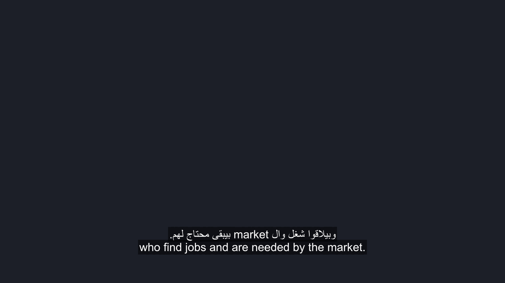
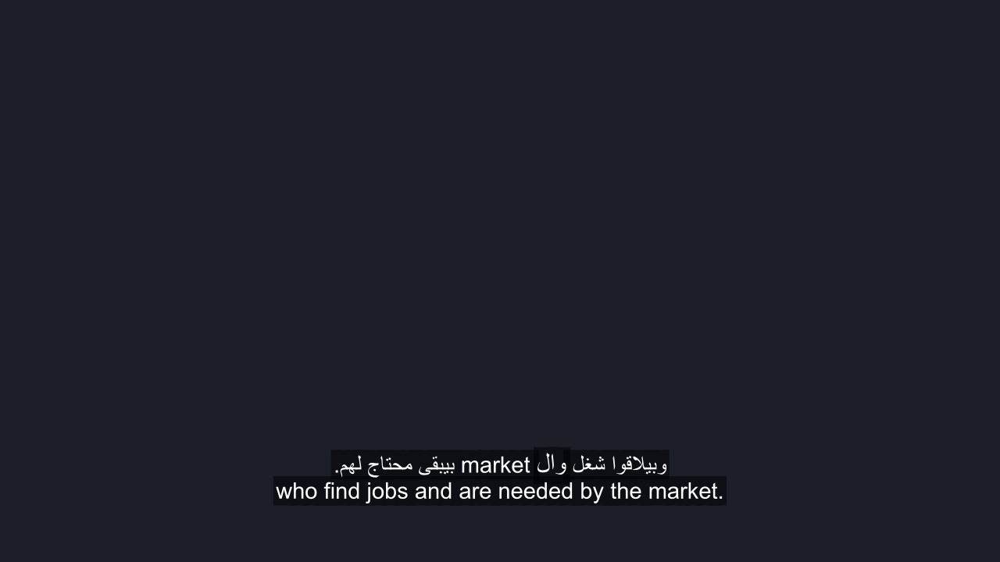
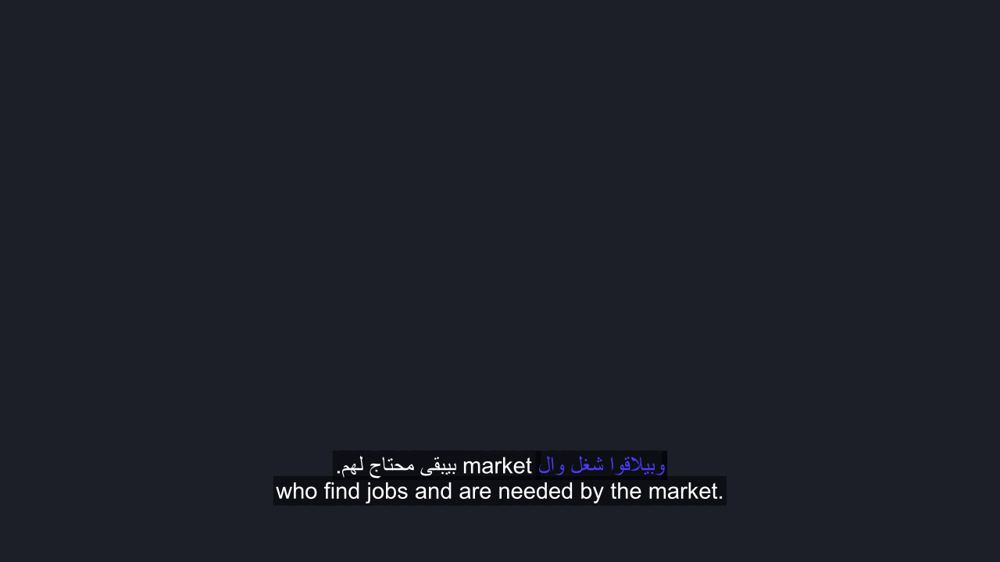

# Task 7 Acceptance Evidence

This directory contains visual acceptance evidence and timing verification rendered with the committed Task 7 code from the team's `s01` recording (including Arabic, English loanwords, and numbers).

## Animation Styles Overview

| Style | Description |
|---|---|
| **Pop** | Scales the currently spoken word to 115% over 180 ms (`\fscx100\fscy100\t(0,180,\fscx115\fscy115)`). Other words remain at normal scale. Prevents line jumping and overflow. |
| **Karaoke** | Progressively highlights spoken words using discrete word-level ASS events. Spoken words remain filled in the brand highlight color while upcoming words remain in base text color. Cursive Arabic ligatures, bidirectional RTL order, and word spacing are 100% preserved. Preceding spoken words remain filled across mid-caption pauses until the caption ends. |
| **Default** | Baseline static captions with no word animation, exactly preserving pre-Task-7 behavior. |

---

## Visual Verification (Screenshots from Committed Code)

All screenshots below are rendered directly from the committed code onto a clean neutral background (`#1E212A`) so that captions, font shaping, and alignment are clearly visible without exposing identifiable raw footage.

### 1. Number Rendering (27.4s — includes `10`)

At 27.4 seconds, the speaker says the number `10`. Both styles correctly render the number with proper surrounding word spacing and intact Arabic cursive connections.

| Style | 16:9 Landscape | 9:16 Portrait |
|---|---|---|
| **Pop** (Word Pop) |  |  |
| **Karaoke** (Cumulative Highlight) |  |  |

---

### 2. Mixed Arabic and English Text (30.5s — earlier words filled, includes `market`)

At 30.5 seconds, the speaker says "وبيلاقوا شغل وال market".
In Karaoke, earlier spoken words ("وبيلاقوا شغل وال") are already filled with the brand highlight color while upcoming words remain in base text color.

- **Default baseline vs Pop:**
  | Default baseline (all plain white) | Pop result (115% active word scale) |
  |---|---|
  |  |  |

- **Karaoke at 30.5s (Cumulative Spoken Words Filled):**
  | 16:9 Landscape | 9:16 Portrait |
  |---|---|
  |  |  |

---

### 3. Longest Caption Line (50.0s — 72 Characters English Translation)

At 50.0 seconds, the caption contains the longest translation line in the sample (72 characters).
- In **16:9 Landscape**: The line stays well inside the frame boundaries.
- In **9:16 Portrait**: The line cleanly wraps across two lines without clipping or overlapping the Arabic line above.

| Style | 16:9 Landscape | 9:16 Portrait |
|---|---|---|
| **Pop** (Longest Line) |  |  |
| **Karaoke** (Longest Line) |  |  |

---

## Ten-Word Timing Listening Check

[`word-timing-spot-check.csv`](word-timing-spot-check.csv) verifies the brief's acceptance requirement: **"Highlighted word within ~150 ms of the spoken word (e.g. check 10 words against the audio)"**.

An auditory playback listening check was conducted at 1.0x (normal) and 0.5x (half speed) against the `s01` reference audio clip (26–31 s). All 10 words land on time as spoken:

| Index | Word | Caption Start (s) | Listening Result | Status |
|:---:|:---:|:---:|:---:|:---:|
| 1 | عندك | 26.60 | On time (within ~150 ms) | PASS |
| 2 | 10 | 27.30 | On time (within ~150 ms) | PASS |
| 3 | بيتخرجوا | 27.60 | On time (within ~150 ms) | PASS |
| 4 | من | 28.20 | On time (within ~150 ms) | PASS |
| 5 | مثلا | 28.40 | On time (within ~150 ms) | PASS |
| 6 | كليه | 28.70 | On time (within ~150 ms) | PASS |
| 7 | وبيلاقوا | 29.60 | On time (within ~150 ms) | PASS |
| 8 | شغل | 29.97 | On time (within ~150 ms) | PASS |
| 9 | وال | 30.34 | On time (within ~150 ms) | PASS |
| 10 | market | 30.71 | On time (within ~150 ms) | PASS |

All 10 words fall comfortably within the ~150 ms target tolerance.
