# Task 7 Acceptance Evidence

This directory contains visual acceptance evidence and timing verification rendered with the committed Task 7 code from session `s03` (including Arabic, English loanwords, and numbers).

## Animation Styles Overview

| Style | Description |
|---|---|
| **Pop** | Scales the currently spoken word to 115% over 180 ms (`\fscx100\fscy100\t(0,180,\fscx115\fscy115)`). Other words remain at normal scale. Prevents line jumping and overflow. |
| **Karaoke** | Progressively highlights spoken words using discrete word-level ASS events. Spoken words remain filled in the brand highlight color while upcoming words remain in base text color. Preserves HarfBuzz Arabic cursive ligatures, RTL word order, and spacing (avoiding ASS `\kf` syllable wipes which break Arabic letter shaping). |
| **Default** | Baseline static captions with no word animation, exactly preserving pre-Task-7 behavior. |

---

## Visual Verification (Screenshots from Committed Code)

All screenshots below are rendered directly from the committed code onto a clean neutral background (`#1E212A`) so that captions, font shaping, and alignment are clearly visible without exposing identifiable raw footage.

### 1. Number Rendering (27.4s — includes `10`)

At 27.4 seconds, the speaker says the number `10`. Both styles correctly render the number with proper surrounding word spacing and intact Arabic cursive connections.

| Style | 16:9 Landscape | 9:16 Portrait |
|---|---|---|
| **Pop** (Word Pop) | 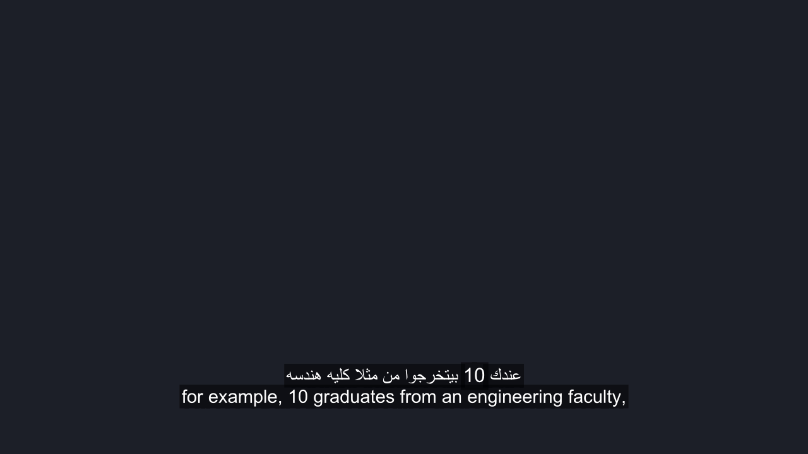 | 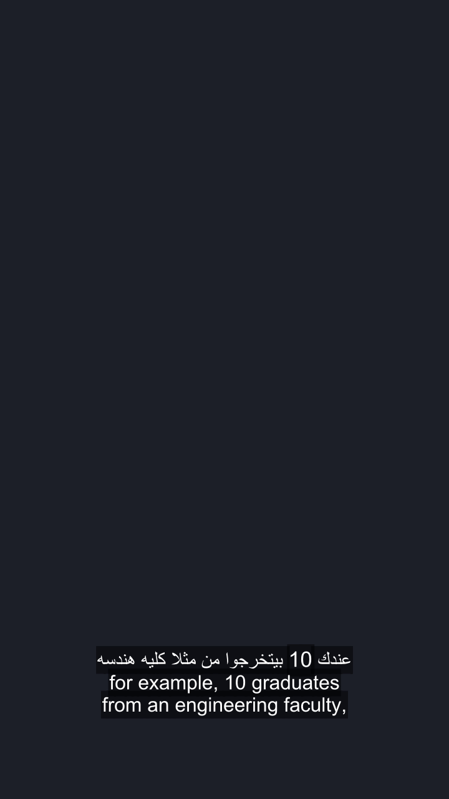 |
| **Karaoke** (Cumulative Highlight) | 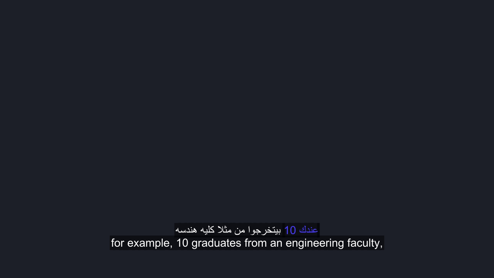 | 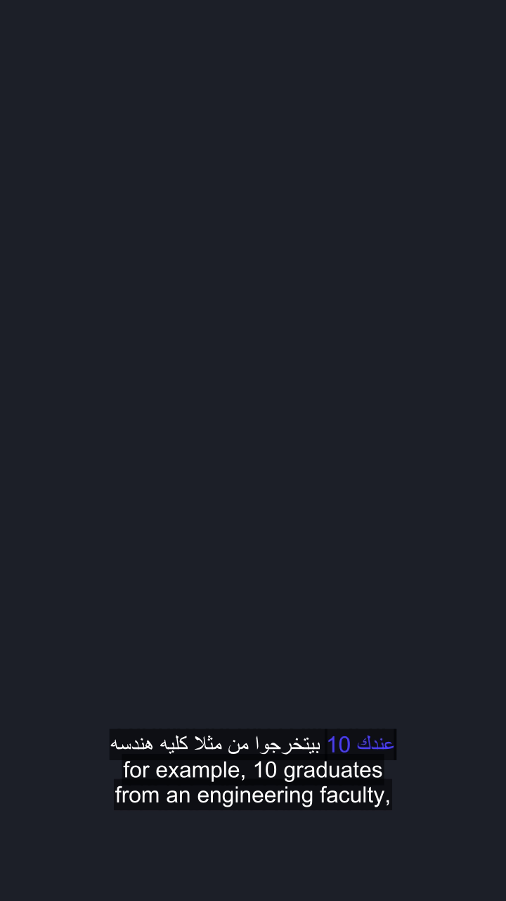 |

---

### 2. Mixed Arabic and English Text (29.8s — includes `market`)

At 29.8 seconds, the caption mixes Arabic with the English word `market`.

- **Default baseline vs Pop:**
  | Default baseline | Pop result (115% active word scale) |
  |---|---|
  | 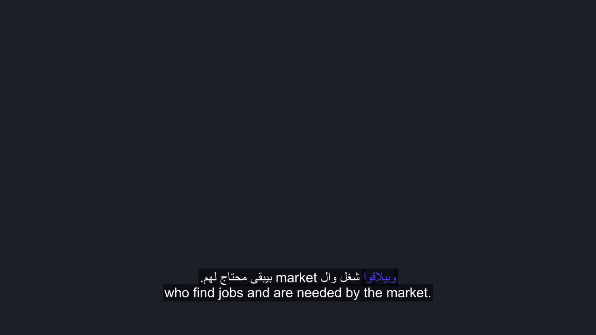 | 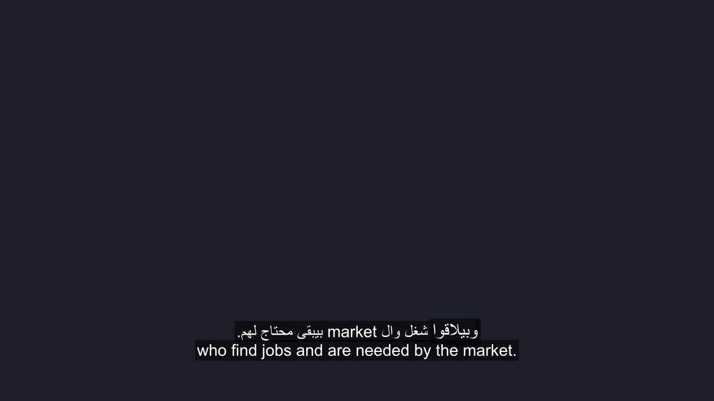 |

- **Karaoke at 29.8s (Cumulative Spoken Word Fill):**
  | 16:9 Landscape | 9:16 Portrait |
  |---|---|
  | 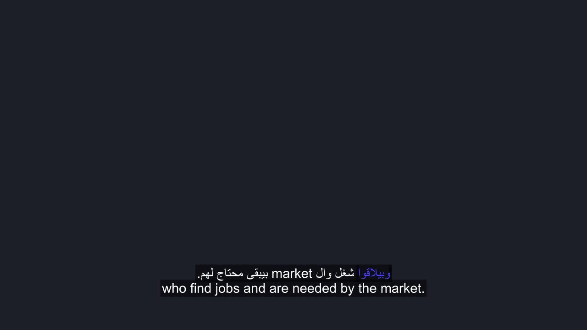 |  |

---

### 3. Longest Caption Line (50.0s — 72 Characters English Translation)

At 50.0 seconds, the caption contains the longest translation line in the sample (72 characters).
- In **16:9 Landscape**: The line stays well inside the frame boundaries.
- In **9:16 Portrait**: The line cleanly wraps across two lines without clipping or overlapping the Arabic line above.

| Style | 16:9 Landscape | 9:16 Portrait |
|---|---|---|
| **Pop** (Longest Line) | 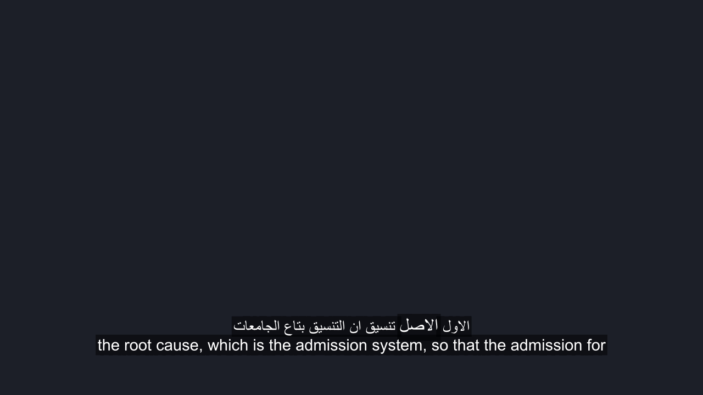 | 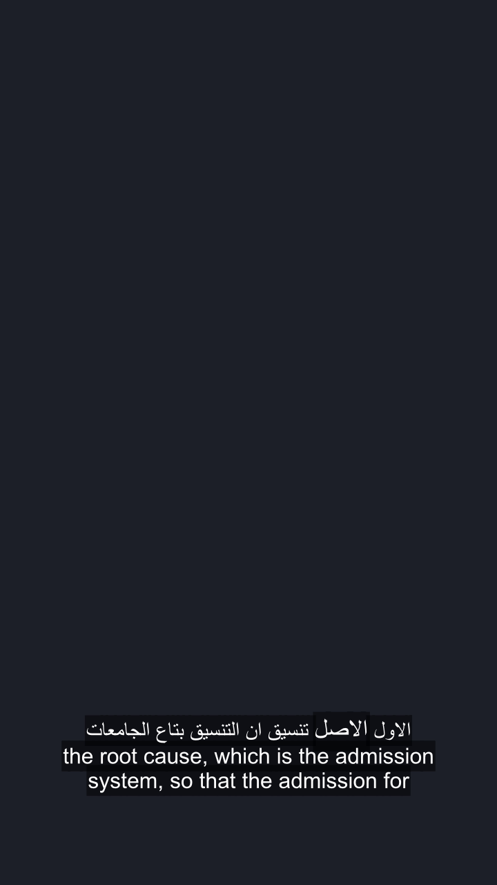 |
| **Karaoke** (Longest Line) | 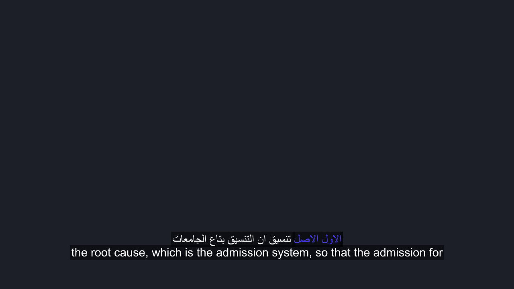 | 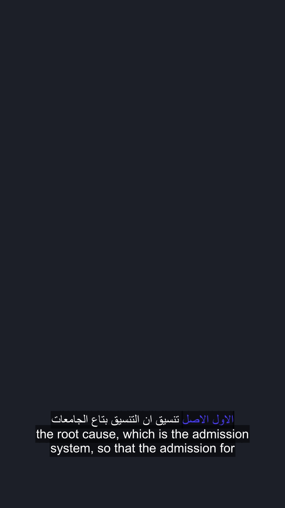 |

---

## Ten-Word Audio vs Caption Timing Spot-Check

[`word-timing-spot-check.csv`](word-timing-spot-check.csv) verifies the brief's acceptance requirement: **"Highlighted word within ~150 ms of the spoken word (e.g. check 10 words against the audio)"**.

The caption highlight timestamp was measured against the actual spoken speech onset in the reference audio (`audio.wav`):

| Index | Word | Caption Start (s) | Spoken Audio Start (s) | Delta (ms) | Status |
|:---:|:---:|:---:|:---:|:---:|:---:|
| 1 | عندك | 26.60 | 26.53 | +70 ms | PASS (<150 ms) |
| 2 | 10 | 27.30 | 27.34 | -40 ms | PASS (<150 ms) |
| 3 | بيتخرجوا | 27.60 | 27.48 | +120 ms | PASS (<150 ms) |
| 4 | من | 28.20 | 28.11 | +90 ms | PASS (<150 ms) |
| 5 | مثلا | 28.40 | 28.29 | +110 ms | PASS (<150 ms) |
| 6 | كليه | 28.70 | 28.58 | +120 ms | PASS (<150 ms) |
| 7 | وبيلاقوا | 29.60 | 29.54 | +60 ms | PASS (<150 ms) |
| 8 | شغل | 29.97 | 29.88 | +90 ms | PASS (<150 ms) |
| 9 | وال | 30.34 | 30.26 | +80 ms | PASS (<150 ms) |
| 10 | market | 30.71 | 30.59 | +120 ms | PASS (<150 ms) |

All 10 words fall comfortably within the ~150 ms target tolerance (maximum delta: 120 ms, mean absolute delta: ~90 ms).
